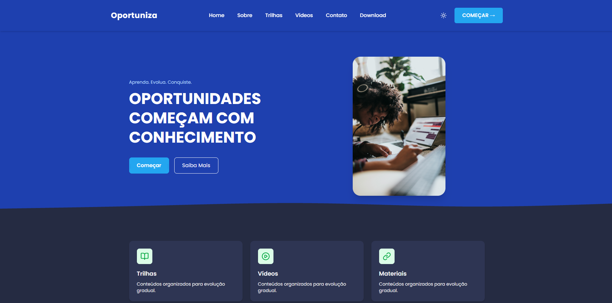
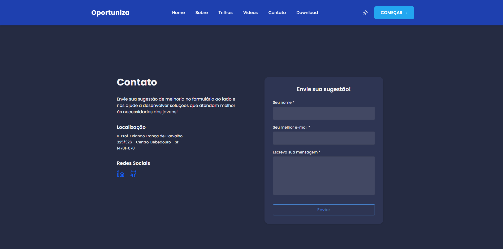

<p align="center">
  

  
  
  <a href="https://github.com/gurjonzito/projeto-oportuniza/commits/master">
    
  </a>
</p>

<details>
  <summary>Table of contents</summary>
  <ol>
    <li><a href="#about">About</a></li>
    <li><a href="#technologies">Technologies</a></li>
    <li><a href="#screenshots">Screenshots</a></li>
    <li><a href="#development">Development</a></li>
    <li><a href="#license">License</a></li>
  </ol>
</details>

## About

Oportuniza is a Full Stack web platform developed as a Final Course Project (TCC) for the Bachelor's Degree in Information Systems.
The project was created with the purpose of helping young people in their professional development through a curated educational video platform, bringing together organized and accessible content focused on employability, technology, professional skills and career growth.

---

## Technologies

### Frontend

* [![React][React]][React-url]
* [![Vite][Vite]][Vite-url]
* [![TypeScript][TypeScript]][TypeScript-url]
* [![TailwindCSS][TailwindCSS]][TailwindCSS-url]

### Backend

* [![NodeJS][NodeJS]][NodeJS-url]
* [![Prisma][Prisma]][Prisma-url]

### Database

* [![PostgreSQL][PostgreSQL]][PostgreSQL-url]

---

## Screenshots




---

## Development

Clone the repository:

```bash
$ git clone https://github.com/gurjonzito/projeto-oportuniza.git
```

---

## License
Distributed under the MIT License. See LICENSE.md for more information.

<!-- Links -->
[React]: https://img.shields.io/badge/React-20232A?style=for-the-badge&logo=react&logoColor=61DAFB
[React-url]: https://react.dev/
[Vite]: https://img.shields.io/badge/Vite-646CFF?style=for-the-badge&logo=vite&logoColor=white
[Vite-url]: https://vitejs.dev/
[NodeJS]: https://img.shields.io/badge/Node.js-339933?style=for-the-badge&logo=nodedotjs&logoColor=white
[NodeJS-url]: https://nodejs.org/
[TypeScript]: https://img.shields.io/badge/TypeScript-007ACC?style=for-the-badge&logo=typescript&logoColor=white
[TypeScript-url]: https://www.typescriptlang.org/
[TailwindCSS]: https://img.shields.io/badge/Tailwind_CSS-38B2AC?style=for-the-badge&logo=tailwind-css&logoColor=white
[TailwindCSS-url]: https://tailwindcss.com/
[PostgreSQL]: https://img.shields.io/badge/PostgreSQL-316192?style=for-the-badge&logo=postgresql&logoColor=white
[PostgreSQL-url]: https://www.postgresql.org/
[Prisma]: https://img.shields.io/badge/Prisma-2D3748?style=for-the-badge&logo=prisma&logoColor=white
[Prisma-url]: https://www.prisma.io/
